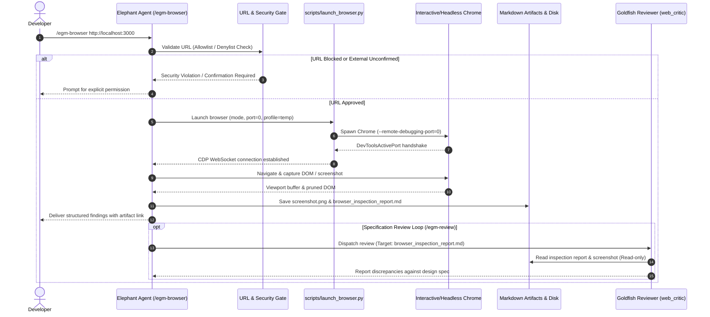

# EGM Browser: Web Inspection & Visual Review Protocol

*   **Status:** Draft. Maintainer scope approval and design review pending.
*   **Authors:** [@Diva143V](https://github.com/Diva143V)
*   **Date:** 2026-11-02
*   **Related Issue:** #270 (`Refs #270`)

--------------------------------------------------------------------------------

## Overview

The **Elephant-Goldfish Model (EGM)** separates the deep-context authoring of technical specifications (**Elephant**) from stateless, zero-context verification (**Goldfish**). Currently, EGM workflows are restricted to static repository text, markdown documents, and local source code.

This design introduces **`egm-browser`**, a browser actuation and web inspection protocol designed to integrate local browser capabilities (via Chrome DevTools MCP and standard headless runtimes) into both the Elephant's exploration workflows and the Goldfish's audit loops. In accordance with EGM's architectural invariants, browser actuation operates under an **asymmetric architecture**: the interactive Elephant acts as the actuation engine that generates static visual and DOM inspection artifacts, while zero-context Goldfish reviewers evaluate those artifacts strictly through read-only tools without requiring execution permissions or direct browser connections.

---

## The Problem

Spec-driven development of web applications, cloud consoles, developer portals, and documentation suites faces critical limitations when restricted to text-only code inspection:

1.  **Invisible Frontend Realities**: Static code inspection cannot verify whether a component rendered cleanly, whether CSS layout constraints failed, or whether dynamic state rendered correctly in the DOM.
2.  **Context Pollution During Web Research**: When the Elephant searches documentation or reads external API schemas directly within the main conversation thread, thousands of tokens of ephemeral HTML/DOM text pollute the context window, degrading subsequent specification drafting.
3.  **Goldfish Visual Blind Spots**: Zero-context Goldfish reviewers can audit API types and logic, but cannot verify whether an implementation matches visual design requirements, responsive layout criteria, or interactive user journeys.
4.  **Credential and Isolation Risks**: Unsandboxed browser actuation risks exposing personal cookies, saved credentials, internal network paths, or state-mutating actions without explicit developer authorization.
5.  **Multi-Harness Execution Divergence**: Operating across disparate agent harnesses (Antigravity IDE, Claude Code CLI, OpenAI Codex) requires a unified contract that handles differing permission models, headless CI runners, and platform display servers.

---

## Goals & Non-Goals

### In-Scope Goals
*   **Interactive Inspection & Actuation**: Provide EGM agents with verified capabilities to navigate to target URLs, wait for network idle, click elements, fill form inputs, and capture DOM state.
*   **Visual Evidence Capture**: Capture resized, compressed viewport screenshots (WebP/JPEG, max 1024x768) stored directly on disk and linked in markdown artifacts.
*   **Cross-Platform Launcher Bridge**: Provide a zero-dependency launcher ([`scripts/launch_browser.py`](file:///d:/egm%20skill/elephant-goldfish-model/scripts/launch_browser.py)) supporting Windows, macOS, and Linux with dynamic ephemeral port binding (`--remote-debugging-port=0`).
*   **Asymmetric Read-Only Review Integration**: Generate static inspection artifacts (`browser_inspection_report.md`) that downstream EGM review subagents (`egm-review`, `web_critic`) can evaluate using standard read-only file tools (`Read`).
*   **Deterministic Process Lifecycle**: Supervise child browser processes via Windows Job Objects (`JOB_OBJECT_LIMIT_KILL_ON_JOB_CLOSE`) and POSIX process groups to prevent orphaned zombie processes.
*   **Structured Error Diagnostics**: Return machine-readable error envelopes differentiating infrastructure failures (`INFRASTRUCTURE_FAILURE`) from target application defects (`TARGET_APP_FAILURE`).

### Out-of-Scope Non-Goals
*   **Deep Performance & Memory Diagnostics**: EGM will not bundle an internal Lighthouse engine, V8 heap snapshot diffing, or Core Web Vitals waterfall tracing. Specialized profiling belongs in dedicated external CLI tools (`lighthouse-ci`, `playwright`).
*   **In-Tree MCP Server Packaging**: EGM runtime packages will not bundle binary Chrome DevTools MCP servers in `plugin.json` (strictly prohibited by `scripts/pack_plugin.py`).
*   **Full End-to-End Test Automation Suite**: The skill is an inspection and spec-verification tool, not a replacement for comprehensive end-to-end test runners like Playwright or Cypress.
*   **Actuation Inside Goldfish Subagents**: Review personas (`agents/*.md`) will never be granted browser execution tools; Goldfish remain strictly read-only.
*   **Bypassing CAPTCHAs & Anti-Bot Systems**: No evasion mechanisms, fingerprint spoofing, or automated CAPTCHA solving.

---

## Design Principles

*   **Asymmetric Elephant-Goldfish Boundary**:
    *   **The Elephant**: Orchestrates actuation, interacts with local development servers or documentation sites, and writes structured inspection reports and screenshots to disk.
    *   **The Goldfish**: Reviews the pre-rendered inspection artifacts in a fresh context, enforcing the spec rubric with zero side-effects and zero network access.
*   **Isolated Profile Execution**: Browser automation operates strictly inside an isolated, disposable browser profile (`$TEMP/egm-browser-profile-*`), preventing access to personal user data, production session cookies, or saved credentials.
*   **Two-Layer URL Security Boundary**: Access is strictly governed by a denylist (blocking internal browser schemes, credentials, and sensitive metadata endpoints) and an allowlist (defaulting to `localhost`, local dev ports, and user-confirmed domains).
*   **Artifact-First UX**: Raw HTML, DOM trees, and large traces must **NEVER** be dumped into the chat thread. All screenshots and audit summaries are written directly to markdown artifacts and surfaced via clean links.
*   **Graceful Multi-Harness Degradation**: The skill actively probes for browser tools and display environments at runtime. If the active harness lacks browser actuation capabilities, it stops cleanly and prompts for manual developer input rather than hallucinating actions.

---

## System Architecture & Workflow



### 1. Upstream Elephant Workflow (`/egm-brainstorm` & `/egm-draft`)
When drafting a specification touching web interfaces or third-party APIs:
1. The Elephant detects the need to inspect live documentation or a running prototype.
2. The Elephant invokes `egm-browser` to capture the visual layout and semantic DOM structure.
3. Extracted findings are summarized concisely into `concepts_brief.md` or `design_draft.md`, while screenshots are persisted in the conversation artifact directory.

### 2. Downstream Goldfish Workflow (`/egm-review`)
During multi-stage specification or implementation review:
1. The orchestrator runs `egm-browser` to capture the live state of the application under review (e.g., `http://localhost:3000`).
2. The orchestrator saves the resulting evidence to `browser_inspection_report.md` and `screenshot.png`.
3. The review loop dispatches a fresh-context reviewer (`web_critic`).
4. The reviewer loads the target specification rubric and reads `browser_inspection_report.md` via standard `Read` tools.
5. Findings are output into `goldfish_review_report.md` for resolution via `/egm-resolve`.

---

## Technical Actuation & Process Management

### 1. Ephemeral Port Allocation (Eliminating TOCTOU Races)
Pre-allocating port 0 via socket check introduces a time-of-check to time-of-use (TOCTOU) race condition during parallel execution. `egm-browser` directs Chrome to allocate an ephemeral port natively by passing `--remote-debugging-port=0`. Upon startup, the launcher parses the assigned port and WebSocket target from the `DevToolsActivePort` file created in Chrome's temporary user-data directory:

```
9342
/devtools/browser/7b134d10-e7f1-43e8-8a8f-89a19c629235
```

### 2. Process Lifecycle & Zombie Reaper
To guarantee that background Chrome instances do not become orphaned zombies upon unexpected agent exits or timeouts:
*   **Windows**: Child processes are assigned to an OS Job Object configured with `JOB_OBJECT_LIMIT_KILL_ON_JOB_CLOSE`. When the parent process terminates, Windows automatically terminates the entire process tree.
*   **macOS / Linux**: Chrome is spawned in a dedicated process group (`os.setpgrp()`) and bound to exit signal handlers (`SIGTERM`, `SIGINT`, `SIGHUP`).
*   **Session Registry**: Spawned PIDs are recorded in `.egm/browser-sessions.json`. Stale processes exceeding a 5-minute idle TTL are forcefully reaped on session initialization.

### 3. Display Mode & Headless Operation
*   **Headless Default**: Standard invocations default to `--headless=new` for consistent rendering across local environments and CI runners.
*   **Visible GUI Mode**: Invoked via `--visible`. The launcher executes a pre-flight display check:
    *   *Windows*: Verifies an active interactive desktop station (`winsta0\default`).
    *   *Linux*: Validates read/write access to `$DISPLAY` or `$WAYLAND_DISPLAY`.
    *   *macOS*: Validates connection to WindowServer.
    If no display is available (e.g. headless CI), the launcher gracefully degrades to `--headless=new` with a diagnostic warning rather than crashing.

### 4. Token Budgeting & DOM Pruning
Raw accessibility trees and full DOM dumps frequently exceed 50,000–100,000 tokens. The skill enforces:
*   **Semantic Pruning**: Filter for interactive and semantic elements (`a`, `button`, `input`, `select`, `h1`-`h6`, `nav`, `main`), stripping unstyled `div`/`span` wrappers.
*   **Depth Ceiling**: Maximum traversal depth of 4 levels from target landmark containers.
*   **Token Cap**: Pruned trees must not exceed 2,000 tokens per capture.
*   **Screenshot Compression**: Viewport captures resized to max 1024x768 with lossy WebP/JPEG compression (quality 75-80%), persisted to disk.

---

## Security & Operational Guardrails

### 1. Two-Layer URL Security Model
*   **Denylist (Absolute Rejection)**:
    *   Internal browser schemes: `chrome://*`, `chrome-extension://*`, `about:*`, `edge://*`.
    *   Local filesystem schemes: `file://*` (handled via standard file-reading tools, not browser actuation).
    *   Cloud metadata endpoints: `http://169.254.169.254/*`, `http://metadata.google.internal/*`.
    *   Sensitive authentication routes unless explicitly authorized by the human operator.
*   **Allowlist (Permitted Targets)**:
    *   Loopback addresses: `http://localhost:*`, `http://127.0.0.1:*`, `http://[::1]:*`.
    *   Whitelisted documentation hosts.
    *   User-confirmed external preview URLs.

### 2. State-Mutating Action Gates
*   **Read-Only Default**: Navigation, page scrolling, DOM extraction, console error capturing, and screenshot generation are permitted autonomously on approved URLs.
*   **Action Confirmation Gate**: Clicking submit buttons, filling input forms, triggering downloads, or executing state-mutating actions requires explicit confirmation in chat.

### 3. Machine-Readable Error Categorization
To prevent false PR rejections and infinite retry loops, errors are classified into distinct domains:
*   `INFRASTRUCTURE_FAILURE`: Chrome crash, socket bind refusal, or MCP daemon disconnect. Triggers exactly 1 automatic retry using a fresh ephemeral port and profile.
*   `TARGET_APP_FAILURE`: Application 500 error, unhandled JavaScript exception, or network refusal from the web server. Disallows retry; recorded directly in the audit report as an application bug.
*   `TIMEOUT_BREACH`: Differentiates navigation timeouts from internal RPC delays.

---

## Multi-Harness Support Matrix

| Harness | Actuation Mechanism | Review Context | Fallback Behavior |
| :--- | :--- | :--- | :--- |
| **Antigravity IDE** | Chrome DevTools MCP / Native Subagent | Read-only static artifact | Full native support |
| **Antigravity CLI** | `scripts/launch_browser.py` + CDP | Read-only static artifact | Headless fallback |
| **Claude Code** | Host-configured MCP / `launch_browser.py` | Read-only (`Read`, `Grep`, `Glob`) | Halt with prompt to provide screenshot |
| **Codex** | Local executor script | Read-only static artifact | Halt with prompt to paste HTML |
| **ChatGPT / omp** | Runtime tool detection | Read-only static artifact | Fallback to user-supplied screenshot |

---

## Alternatives Considered

1.  **Plain HTTP Scraping (`curl` / `fetch` / `requests`)**:
    *   *Rejected*: Cannot execute client-side JavaScript, cannot render modern single-page applications (React, Astro, Vue), and cannot capture visual screenshots for UI audits.
2.  **Embedded Headless Browser in Root Agent Context**:
    *   *Rejected*: Ingesting full rendered HTML strings into the root conversation severely pollutes the Elephant's context and violates the zero-context Goldfish isolation principle.
3.  **Monolithic All-In-One APM/QA Suite (Lighthouse, LCP, Memory Diffs, Cookies)**:
    *   *Rejected*: Violates YAGNI and expands EGM's scope from specification design into runtime APM. Exceeds the 24,000-byte `SKILL.md` load limit and creates heavy maintenance debt.
4.  **In-Tree MCP Server Packaging in `plugin.json`**:
    *   *Rejected*: Strictly forbidden by `pack_plugin.py` and `test_refuses_unbundled_services`. Breaks portable packaging and multi-harness distribution across Claude Code and Codex.
5.  **Direct Port Pre-Reservation (Port 0 Socket Probe)**:
    *   *Rejected*: Subject to TOCTOU race conditions under parallel subagent execution. Replaced with native Chrome ephemeral port binding (`--remote-debugging-port=0`) and `DevToolsActivePort` reading.

---

## Risks & Mitigations

*   **Risk 1: Credential & Profile Leakage**:
    *   *Mitigation*: Enforce separate ephemeral Chrome profiles with zero shared state from the user's primary browsing profile.
*   **Risk 2: Flaky Rendering & Dynamic Loading**:
    *   *Mitigation*: Implement explicit DOM readiness gates (e.g. `networkidle`, DOMContentLoaded, or element presence checks) before capturing review snapshots.
*   **Risk 3: Harness Drift & Unimplemented Tool Errors**:
    *   *Mitigation*: Unit test tool detection probes; halt with clear, actionable diagnostics when a harness lacks browser capabilities.
*   **Risk 4: Goldfish Read-Only Isolation Violation**:
    *   *Mitigation*: Asymmetric architecture. Actuation is confined to the Elephant layer; Goldfish reviewers evaluate pre-rendered static artifacts using standard file tools.

---

## Implementation Plan (Stage 2 Enumeration)

Once this design specification is approved and merged, the Stage 2 implementation will add the following files:

| Target File | Component | Architectural Purpose |
| :--- | :--- | :--- |
| `skills/egm-browser/SKILL.md` | Skill Definition | Standalone skill instructions, frontmatter, and execution protocol (<= 24,000 bytes). |
| `skills/egm-browser/references/*.md` | Reference Guides | Modular guides for URL security gating, CLI automation, and troubleshooting. |
| `skills/egm-browser/test_scenarios.yaml` | Evaluation Suite | Co-located behavioral evaluation scenarios for URL gating and artifact reporting. |
| `skills/egm-browser/TEST.md` | Verification Playbook | Manual checklist for interactive protocol verification. |
| `skills/egm-browser/assets/icon.svg` | Visual Identity | Canonical 28px/40px SVG icon adhering to EGM icon standard. |
| `skills/egm-browser/agents/openai.yaml` | Manifest Extension | OpenAI/Codex interface descriptor for marketplace compatibility. |
| `scripts/launch_browser.py` | Platform Bridge | Cross-platform browser discovery, ephemeral port binding, and process supervision. |
| `agents/web_critic.md` | Reviewer Persona | Specialized Goldfish reviewer persona for visual/DOM audit against specs. |
| `scripts/pack_plugin.py` | Build System | Register `egm-browser` in packaged runtime bundles. |
| `tests/unit/test_harnesses.py` | Unit Tests | Add `egm-browser` to `EXPECTED_SKILLS` set. |
| `tests/unit/test_packaging.py` | Unit Tests | Increment skill count assertion (7 -> 8). |
| `tests/unit/test_browser_skill.py` | Unit Tests | Reference parity, link integrity, and launcher unit tests. |
| `site/src/components/SkillIcon.astro` | Documentation Site | Import canonical icon for `egm.dev`. |
| `site/src/components/Skills.astro` | Documentation Site | Feature `egm-browser` in the website skill catalog. |
| `README.md` | Documentation | Register `egm-browser` in the primary skill directory table. |
