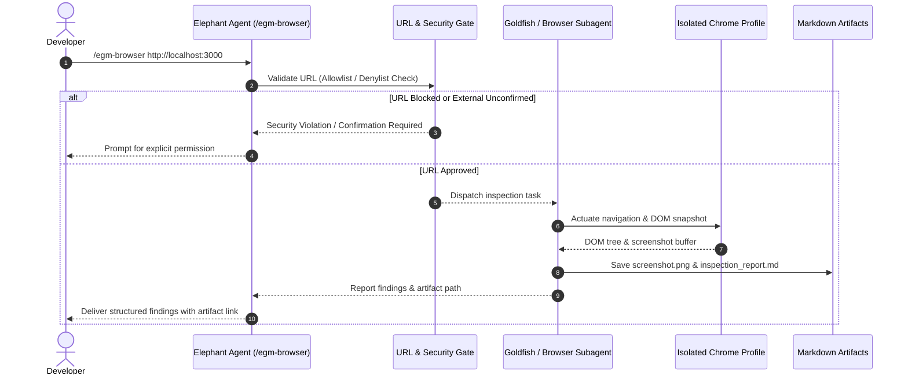

# EGM Browser: Web Inspection & Visual Review Protocol

*   **Status:** Draft. Maintainer scope approval and design review pending.
*   **Authors:** EGM Contributor Community
*   **Date:** 2026-11-01
*   **Related Issue:** #270 (`Refs #270`)

--------------------------------------------------------------------------------

## Overview

The **Elephant-Goldfish Model (EGM)** separates the deep-context authoring of technical specifications (**Elephant**) from stateless, zero-context verification (**Goldfish**). Currently, all EGM workflows are restricted to static repository text, markdown documents, and local source code.

This design introduces **`egm-browser`**, a browser actuation and web inspection protocol designed to integrate local browser capabilities (such as Google Antigravity's Browser Subagent and isolated Chrome profile) into both the Elephant's exploration workflows and the Goldfish's audit loops.

## The Problem

Spec-driven development of web applications, cloud consoles, developer portals, and documentation suites faces critical limitations when restricted to text-only code inspection:

1.  **Invisible Frontend Realities**: Static code inspection cannot verify whether a component rendered cleanly, whether layout constraints failed, or whether dynamic state rendered correctly in the DOM.
2.  **Context Pollution During Web Research**: When the Elephant searches documentation or reads external API schemas directly within the main conversation thread, thousands of tokens of ephemeral HTML/DOM text pollute the context window, degrading subsequent specification drafting.
3.  **Goldfish Visual Blind Spots**: Zero-context Goldfish reviewers can audit API types and logic, but cannot verify whether an implementation matches visual design requirements, responsive layout criteria, or interactive user journeys.
4.  **Credential and Isolation Risks**: Unsandboxed browser actuation risks exposing personal cookies, saved credentials, internal network paths, or state-mutating actions without explicit developer authorization.

## Design Principles

*   **Elephant-Goldfish Browser Division**:
    *   **The Elephant**: Uses the browser for upstream research, referencing live documentation and verifying local dev servers during `/egm-brainstorm` and `/egm-draft`.
    *   **The Goldfish**: Spawns in a clean, fresh subagent context to inspect the running web application or documentation site against the specification rubric, without knowledge of earlier conversational drafts.
*   **Isolated Profile Execution**: Browser automation operates strictly inside an isolated, disposable browser profile, preventing access to personal user data, production session cookies, or saved credentials.
*   **Two-Layer URL Security Boundary**: Access is strictly governed by a denylist (blocking settings, credentials, and dangerous schemas) and an allowlist (defaulting to `localhost`, local dev server ports, and explicitly allowed documentation domains).
*   **Artifact-First UX**: Raw HTML, DOM trees, and large traces must **NEVER** be dumped into the chat thread. All screenshots, visual diffs, and audit reports are written directly to disk/artifacts and surfaced via clean markdown links.
*   **Graceful Multi-Harness Degradation**: The skill must actively probe for browser tools at runtime. If the active harness lacks browser actuation capabilities, it stops cleanly and prompts for manual developer input rather than hallucinating browser actions.

## System Architecture & Workflow

### Upstream Elephant Workflow (`/egm-brainstorm` & `/egm-draft`)
When drafting a specification that touches web interfaces or third-party APIs:
1. The Elephant detects the need to inspect live documentation or a running prototype.
2. The Elephant invokes the browser capability to capture relevant schema or visual state.
3. Extracted findings are summarized concisely into `concepts_brief.md` or `design_draft.md`, while screenshots are persisted in the conversation artifact directory.

### Downstream Goldfish Workflow (`/egm-review`)
During multi-stage specification or implementation review:
1. The review loop dispatches a fresh-context reviewer (`web_critic` or `egm-browser`).
2. The reviewer loads the target specification rubric and the target preview URL (e.g. `http://localhost:3000`).
3. The reviewer actuates the isolated browser, captures rendered states and console errors, and cross-references them against the specification requirements.
4. Findings are output into `goldfish_review_report.md` for resolution via `/egm-resolve`.

## Security & Operational Guardrails

### 1. Two-Layer URL Security Model
*   **Denylist (Absolute Rejection)**:
    *   Internal browser protocols: `chrome://*`, `chrome-extension://*`, `about:*`, `edge://*`.
    *   Local filesystem paths: `file://*` (handled via standard file-reading tools, not browser actuation).
    *   Sensitive identity/credential providers unless explicitly permitted by the human operator.
*   **Allowlist (Permitted Targets)**:
    *   Loopback addresses: `http://localhost:*`, `http://127.0.0.1:*`, `http://[::1]:*`.
    *   Whitelisted documentation hosts (e.g., standard language and framework documentation).
    *   User-confirmed external preview URLs.

### 2. State-Mutating Action Gates
*   **Read-Only Default**: Navigation, page scrolling, DOM tree extraction, console log capturing, and screenshot generation are permitted autonomously on approved URLs.
*   **Action Confirmation Gate**: Clicking submit buttons, filling form fields, executing file downloads, or performing non-GET actions requires explicit human confirmation in chat.

## Multi-Harness Support Matrix

| Harness | Browser Mechanism | Context Isolation | Fallback Behavior |
| :--- | :--- | :--- | :--- |
| **Antigravity IDE** | Native Browser Subagent | Isolated Chrome Profile | Full native support |
| **Antigravity CLI** | Native Browser Subagent / CLI bridge | Sandboxed profile | Fallback to user-supplied URL/HTML |
| **Claude Code** | Puppeteer / Playwright tool / MCP | Host sandbox | Halt with instruction to provide HTML/screenshot |
| **Codex** | Local executor browser script / MCP | Temporary directory | Halt with prompt to paste page content |
| **ChatGPT / omp** | Tool detection at runtime | Varies by session | Direct dispatch or user prompt fallback |

## Alternatives Considered

1.  **Plain HTTP Scraping (`curl` / `fetch` / `requests`)**:
    *   *Rejected*: Cannot execute client-side JavaScript, cannot render modern single-page applications (React, Astro, Vue), and cannot capture visual screenshots for UI audits.
2.  **Embedded Headless Browser in Root Agent Context**:
    *   *Rejected*: Ingesting full rendered HTML strings into the root conversation severely pollutes the Elephant's context and violates the zero-context Goldfish isolation principle.
3.  **Unrestricted Interactive Remote Browsing**:
    *   *Rejected*: Exposes user credentials, risks accidental data mutation or financial transactions, and introduces unpredictable latency.

## Risks & Mitigations

*   **Risk 1: Credential & Profile Leakage**:
    *   *Mitigation*: Enforce separate ephemeral Chrome profiles with zero shared state from the user's primary browsing profile.
*   **Risk 2: Flaky Rendering & Dynamic Loading**:
    *   *Mitigation*: Implement explicit DOM readiness gates (e.g. `networkidle`, DOMContentLoaded, or element presence checks) before capturing review snapshots.
*   **Risk 3: Harness Drift & Unimplemented Tool Errors**:
    *   *Mitigation*: Unit test tool detection probes; halt with clear, actionable diagnostics when a harness lacks browser capabilities.

## Implementation Plan (Stage 2 Enumeration)

Once this design specification is approved and merged, the Stage 2 implementation will add the following files:

| Target File | Component | Architectural Purpose |
| :--- | :--- | :--- |
| `skills/egm-browser/SKILL.md` | Skill Definition | Standalone skill instructions, frontmatter, and execution protocol. |
| `skills/egm-browser/test_scenarios.yaml` | Evaluation Suite | Co-located behavioral evaluation scenarios for URL gating and artifact reporting. |
| `skills/egm-browser/TEST.md` | Verification Playbook | Manual checklist for interactive protocol verification. |
| `skills/egm-browser/assets/icon.svg` | Visual Identity | Canonical 28px/40px SVG icon adhering to EGM icon standard. |
| `skills/egm-browser/agents/openai.yaml` | Manifest Extension | OpenAI/Codex interface descriptor for marketplace compatibility. |
| `agents/web_critic.md` | Reviewer Persona | Specialized Goldfish reviewer persona for visual/DOM audit against specs. |
| `scripts/pack_plugin.py` | Build System | Register `egm-browser` in packaged runtime bundles. |
| `tests/unit/test_harnesses.py` | Unit Tests | Add `egm-browser` to `EXPECTED_SKILLS` set. |
| `tests/unit/test_packaging.py` | Unit Tests | Increment skill count assertion (7 -> 8). |
| `site/src/components/SkillIcon.astro` | Documentation Site | Import canonical icon for `egm.dev`. |
| `site/src/components/Skills.astro` | Documentation Site | Feature `egm-browser` in the website skill catalog. |
| `README.md` | Documentation | Register `egm-browser` in the primary skill directory table. |

